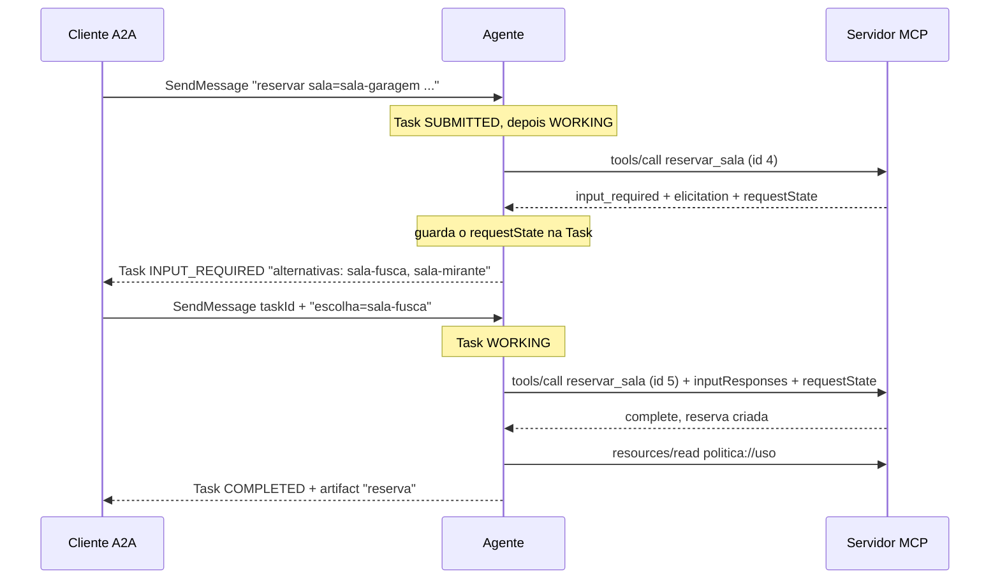

# A Ponte: um agente A2A com MCP por dentro

Desafio de protocolos do MBA em Engenharia de Software com IA da Full Cycle. Este repositório é um fork de [devfullcycle/desafio-a2a-com-mcp](https://github.com/devfullcycle/desafio-a2a-com-mcp), onde está o enunciado original.

O domínio é bobo de propósito: cinco salas de reunião e três regras de uso. O difícil é o estado. Nem o MCP nem o A2A têm sessão, e os dois resolvem isso de jeitos diferentes. O MCP devolve um `requestState` ao cliente e espera ele de volta no retry. O A2A tem a Task, com identidade e estado. Quando a sala pedida está ocupada, esses dois mecanismos precisam se encontrar dentro do agente.

## Minha implementação

Dois processos em Python 3.12: um servidor MCP em Streamable HTTP sem sessão (porta 7301) e um agente que consome esse servidor por dentro e se oferece como servidor A2A v1.0 por fora (porta 7300). As decisões que valem registro:

- **O agente traduz protocolo e não sabe nada de sala.** Conflito, política e alternativas são decisão do servidor MCP. O agente só decide o que cada resposta dele significa para a Task.
- **Sem LLM no caminho.** O pedido chega em formato fixo e o mesmo pedido dá sempre o mesmo resultado.
- **O estado da pausa viaja, não fica guardado.** O pedido e as alternativas vão dentro do `requestState`, selado pelo SDK com AES-256-GCM. Um retry depois de reiniciar o servidor conclui a reserva.
- **O agente vê o `input_required` cru.** A chamada sai pelo nível de sessão do SDK, então quem responde a pergunta é o cliente A2A, e não um callback.
- **O `requestState` nunca sai do agente.** Fica preso à Task e não entra em nenhuma resposta A2A.
- **Validador do desafio: 36 de 36**, e os passos manuais do avaliador que ele não cobre (restart, adulteração e capability ausente) conferidos à parte.

| Arquivo | O que tem |
|---|---|
| `servidor-mcp/servidor.py` | As três tools, o resource, o ciclo de MRTR e o log de cada request no stderr |
| `servidor-mcp/dominio.py` | Salas, reservas, política e a regra das alternativas. Não conhece MCP. |
| `agente/app.py` | Agent Card, `SendMessage` e `GetTask` |
| `agente/ponte.py` | A costura entre os dois protocolos |
| `agente/tasks.py` | A Task e o que fica guardado quando ela pausa |
| `agente/cliente_mcp.py` | O cliente MCP: descoberta, política, `tools/call` e `traceparent` |

Nenhum arquivo do agente importa código do servidor.

## Como rodar

### Pré-requisitos

- [uv](https://docs.astral.sh/uv/). Ele baixa o Python 3.12 fixado em `.python-version` se for preciso.
- Python 3.10 ou superior no sistema, para o validador.
- Nenhum serviço externo e nenhuma chave de API.

### Variáveis

| Variável | Obrigatória | O que é |
|---|---|---|
| `REQUEST_STATE_SECRET` | sim, no servidor MCP | Chave que protege o `requestState`. No mínimo 32 bytes. |
| `MCP_HOST`, `MCP_PORT` | não | Onde o servidor MCP escuta. Padrão: `127.0.0.1` e `7301` |
| `AGENTE_HOST`, `AGENTE_PORT` | não | Onde o agente escuta. Padrão: `127.0.0.1` e `7300` |
| `AGENTE_URL` | não | URL publicada no Agent Card. Padrão: `http://127.0.0.1:7300` |
| `MCP_URL` | não | Endpoint MCP que o agente chama. Padrão: `http://127.0.0.1:7301/mcp` |

### Comandos

```bash
git clone https://github.com/ElderGil/desafio-a2a-com-mcp.git && cd desafio-a2a-com-mcp
uv sync                     # instala as dependências, com mcp==2.3.0 fixado
```

Gere a chave e exporte no terminal do servidor MCP. O valor não vai para o repositório.

```bash
export REQUEST_STATE_SECRET=$(python3 -c "import secrets; print(secrets.token_hex(32))")
```

```bash
uv run servidor-mcp/servidor.py     # terminal 1: servidor MCP em http://localhost:7301/mcp
uv run agente/app.py                # terminal 2: agente em http://localhost:7300/a2a
python3 validador/validar.py --agente http://localhost:7300 --mcp http://localhost:7301   # terminal 3
```

O stderr do servidor MCP mostra uma linha por request, com método, id, `traceparent` e capabilities. É o instrumento de depuração deste desafio.

Duas coisas para não perder tempo:

- Rode o validador sempre com os dois processos recém-iniciados. As reservas de uma execução mudam o resultado da seguinte. O `./subir.sh` faz isso: encerra o que estiver escutando nas duas portas e sobe os dois do zero, com o stderr do servidor MCP no terminal e cópia em `logs/`.
- Para testar o retry depois de um restart, suba o servidor MCP de novo no mesmo terminal. Se a chave mudar, o `requestState` emitido antes deixa de valer, que é o comportamento certo.

Sem `uv`: `python3.12 -m venv .venv && .venv/bin/pip install -r requirements.txt`, e troque `uv run` por `.venv/bin/python`. Testei num clone limpo: 36 de 36.

### A ponte na mão

Reinicie os dois processos antes destes comandos se o validador acabou de rodar (`./subir.sh` resolve). O validador reserva a `sala-fusca` e a `sala-mirante` das 14h às 15h, que são justamente as alternativas da `sala-garagem`. Sem reiniciar, o pedido abaixo termina em `TASK_STATE_FAILED` com "Sem alternativas disponiveis no intervalo", que é a resposta certa para aquele estado, mas não é o que você quer conferir.

```bash
curl -s http://localhost:7300/.well-known/agent-card.json

# sala ocupada: a Task para em TASK_STATE_INPUT_REQUIRED com "alternativas: sala-fusca, sala-mirante"
python3 -c "import json;print(json.dumps(json.load(open('exemplos/wire/08-a2a-send-message.json'))['request']['body']))" \
  | curl -s http://localhost:7300/a2a -H 'Content-Type: application/json' \
      -H 'traceparent: 00-4bf92f3577b34da6a3ce929d0e0e4736-00f067aa0ba902b7-01' -d @-

# continuação: troque <task-id> pelo id devolvido acima
curl -s http://localhost:7300/a2a -H 'Content-Type: application/json' -d '{
  "jsonrpc":"2.0","id":2,"method":"SendMessage",
  "params":{"message":{"messageId":"msg-2","role":"ROLE_USER","taskId":"<task-id>","parts":[{"text":"escolha=sala-mirante"}]}}}'

curl -s http://localhost:7300/a2a -H 'Content-Type: application/json' \
  -d '{"jsonrpc":"2.0","id":3,"method":"GetTask","params":{"id":"<task-id>"}}'
```

## Onde a ponte acontece

Toda a costura está em `agente/ponte.py`. O fluxo de uma sala ocupada:



**O `input_required` do MCP vira `TASK_STATE_INPUT_REQUIRED`** em `agente/ponte.py:119-132`, dentro de `_aplicar`. O `requestState` fica na Task; para o cliente A2A sai só a linha de alternativas.

```python
task.pausa = Pausa(
    request_state=resultado.request_state,
    chave=chave,
    alternativas=_alternativas(pedido),
    argumentos=argumentos,
)
task.responder(INPUT_REQUIRED, _linha_de_alternativas(task.pausa))
```

**O `requestState` volta para o servidor** em `agente/ponte.py:91-99`, dentro de `continuar`. Mesma tool, mesmos argumentos, a mesma chave que veio no `inputRequests` e o valor ecoado sem abrir. É um request JSON-RPC novo, com id novo.

```python
await _chamar(
    task,
    pausa.argumentos,
    mcp,
    input_responses={pausa.chave: resposta},
    request_state=pausa.request_state,
)
```

`agente/cliente_mcp.py:97`: o agente só enxerga o `input_required` cru porque a chamada sai pelo nível de sessão do SDK com `allow_input_required=True`. O `Client.call_tool` comum responderia a elicitation sozinho, o ciclo fecharia dentro do cliente e a Task nunca pausaria.

`agente/tasks.py:73-83`: `para_wire` é a única saída da Task para o cliente A2A, e ela serializa `id`, `contextId`, `status`, `history` e `artifacts`. A pausa não está na lista, então o `requestState` não tem como vazar.

Do outro lado, em `servidor-mcp/servidor.py`: `_perguntar` (`:136`) é onde o servidor termina a resposta pedindo a escolha, e `_retomar` (`:165`) é onde ele reconstrói o pedido a partir do `requestState` e conclui.

## Decisões técnicas

### Como o `requestState` é protegido

`servidor-mcp/servidor.py:63`: usei o utilitário do SDK, sem criptografia própria.

```python
request_state_security=RequestStateSecurity(keys=[chave_de_integridade()], ttl=VALIDADE_DO_REQUEST_STATE),
```

A tool escreve e lê texto claro. O SDK sela na saída e verifica na volta com AES-256-GCM, com a chave derivada de `REQUEST_STATE_SECRET`. O selo também amarra o token ao método, à tool, a um digest dos argumentos e ao nome do servidor. Trocar um caractere, deixar expirar ou reenviar com outros argumentos dá o mesmo resultado: `-32602` com "Invalid or expired requestState", antes de chegar na tool. O servidor não sobe sem a variável ou com menos de 32 bytes (`servidor.py:48-55`), e não existe chave no código.

Vale por 15 minutos, dentro da faixa de 5 a 30 pedida. Para ver a expiração sem esperar, rodei uma cópia do servidor com validade de 3 segundos: o retry imediato conclui, e o retry depois de 5 segundos devolve o mesmo `-32602`, com `requestState rejected on tools/call: expired` no log.

### O que viaja nele

`servidor-mcp/servidor.py:156`: o pedido original e as alternativas oferecidas.

```python
estado = {"pergunta": CHAVE_DA_PERGUNTA, "pedido": pedido, "alternativas": alternativas}
```

O servidor não guarda nada entre o `input_required` e o retry. No retry valem os valores selados, e a escolha precisa estar entre as alternativas seladas.

### Duas coisas que só descobri rodando

A primeira versão do servidor usava `Resolve` e `Elicit`, o caminho que a documentação do SDK recomenda: um resolver devolve a pergunta e o SDK monta o `input_required` sozinho. Passou nas 36 verificações do validador. Choque de realidade: falhou no passo 12 do fluxo do avaliador, o do retry depois de um restart.

O motivo é que o SDK só aceita a resposta se a pergunta, renderizada de novo no retry, for idêntica à que foi selada. As alternativas dependem das reservas em memória. Se uma alternativa foi reservada antes da pausa, ela não entra na pergunta. Depois do restart as reservas voltam ao estado inicial, a lista muda, e o servidor pergunta de novo em vez de concluir. O validador não pega porque não reinicia nada.

Por isso `reservar_sala` devolve o `InputRequiredResult` ela mesma, e as alternativas viajam dentro do estado selado. O custo foi escrever a checagem de capability que o resolver fazia sozinho (`_exigir_elicitation_em_form`, `servidor.py:191`, erro `-32021`).

A segunda: o cliente do SDK não declara só o form mode. O enunciado pede `{"elicitation": {"form": {}}}` e o cliente Python 2.3.0 anuncia `form` e `url` sempre que existe um callback de elicitation registrado. Está em `mcp/client/session.py`, em `_build_capabilities`:

```python
elicitation = (
    types.ElicitationCapability(form=types.FormElicitationCapability(), url=types.UrlElicitationCapability())
    if self._elicitation_callback is not _default_elicitation_callback
    else None
)
```

Tentei sobrepor a chave `io.modelcontextprotocol/clientCapabilities` no `_meta` de cada request, e o SDK carimba o valor dele por cima. É uma limitação real do SDK. O form mode é declarado em todo request, que é o que o critério de aceite exige, e o `url` vem a mais. Preferi manter o cliente oficial a reescrever o transporte para tirar um campo. O stderr do servidor MCP mostra as capabilities recebidas em cada request.

### Onde ficam as Tasks

Num dicionário em memória no agente (`Tarefas`, `agente/tasks.py:86`). Reiniciar o agente perde as Tasks, o que o enunciado permite. O que precisa sobreviver a um restart é o `requestState`, e ele sobrevive porque o estado viaja nele e não no servidor. A pausa é por Task, então duas Tasks pausadas ao mesmo tempo não trocam de `requestState`.

### A2A sem SDK

O binding JSON-RPC deste desafio são dois métodos e um GET. Escrevi direto em Starlette, e assim a ordem dos estados e a leitura do header `traceparent` ficam à vista. Mensagem para Task em estado terminal devolve `-32004` (`agente/app.py:107`). Task que não existe, `-32001`. Pedido fora do formato fixo, `-32602`, sem abrir Task: erro de contrato falha o request, falta de contexto de negócio pausa a Task.

Quando a tool devolve erro de execução, a Task termina em `TASK_STATE_FAILED` com a mensagem da tool, sem o prefixo `Error executing tool reservar_sala:` que o SDK do servidor acrescenta (`agente/ponte.py`, `_mensagem_da_tool`). Para quem chama, o agente é opaco: o cliente A2A não precisa saber que existe uma tool atrás dele.

## Saída do validador

Última execução, com os dois processos recém-iniciados. Código de saída 0.

```
trace-id desta execucao: 3c0e32f53928ec483185b40e9fe94408
procure esse valor no stderr do servidor MCP para conferir a propagacao do traceparent.

PASS 01 tools/list traz as tres tools
PASS 02 toda tool tem inputSchema de objeto
PASS 03 listar_salas devolve structuredContent e o mesmo JSON em texto
PASS 04 _meta sem protocolVersion devolve -32602 e HTTP 400
PASS 05 _meta sem clientCapabilities devolve -32602 e HTTP 400
PASS 06 tool inexistente e recusada, por -32602 ou por isError
PASS 07 resources/read de politica://uso devolve a politica
PASS 08 resources/read de URI inexistente devolve -32602
PASS 09 sala inexistente devolve isError com a mensagem exata
PASS 10 fora da janela devolve isError com a mensagem exata
PASS 11 duracao acima de 2h devolve isError com a mensagem exata
PASS 12 intervalo invertido devolve isError com a mensagem exata
PASS 13 conflito devolve input_required com inputRequests e requestState
PASS 14 a elicitation e form mode e oferece as alternativas na ordem certa
PASS 15 conflito sem a capability elicitation devolve -32021 e HTTP 400
PASS 16 retry com inputResponses e requestState conclui a reserva
PASS 17 requestState adulterado e rejeitado com -32602
PASS 18 argumentos adulterados no retry nao tomam efeito
PASS 19 recusa conclui sem reservar e sem isError
PASS 20 conflito sem alternativa possivel devolve isError com a mensagem exata

PASS 21 agent card responde 200 no well-known com JSON
PASS 22 o card declara a interface JSON-RPC com url e versao 1.0
PASS 23 o card declara a skill reservar-sala
PASS 24 SendMessage com sala livre conclui a Task
PASS 25 o artifact chama reserva e traz a versao da politica
PASS 26 GetTask devolve id, contextId e estado corrente
PASS 27 SendMessage com sala ocupada pausa a Task
PASS 28 a Task pausada lista as alternativas na ordem certa
PASS 29 escolha fora do enum mantem a Task pausada
PASS 30 a continuacao conclui a Task na sala escolhida
PASS 31 SendMessage em Task terminal e recusado
PASS 32 a recusa termina a Task em CANCELED
PASS 33 duas Tasks pausadas ao mesmo tempo concluem cada uma com a sua reserva
PASS 34 nenhuma resposta A2A carrega o requestState
PASS 35 sala inexistente termina a Task em FAILED com a mensagem da tool
PASS 36 o agente e deterministico: o mesmo pedido produz a mesma pausa

resumo: 36 passaram, 0 falharam, de 36 verificacoes
```

O stderr do servidor MCP na mesma execução. O `tools/list` do agente (id 1) vem antes do primeiro `tools/call`, com o trace-id que o validador imprimiu. O par da reserva que passou pela pausa é o id 4 (pedido inicial) e o id 5 (retry).

```
[mcp] metodo=tools/list id=1 alvo=- traceparent=00-3c0e32f53928ec483185b40e9fe94408-4b96a4d24e473fc1-01 capabilities={"elicitation":{"form":{},"url":{}}}
[mcp] metodo=tools/call id=2 alvo=reservar_sala traceparent=00-3c0e32f53928ec483185b40e9fe94408-dd00b21798a134ef-01 capabilities={"elicitation":{"form":{},"url":{}}}
[mcp] metodo=resources/read id=3 alvo=politica://uso traceparent=00-3c0e32f53928ec483185b40e9fe94408-bc53f7510d100705-01 capabilities={"elicitation":{"form":{},"url":{}}}
[mcp] metodo=tools/call id=4 alvo=reservar_sala traceparent=00-3c0e32f53928ec483185b40e9fe94408-600d062a3df5c7af-01 capabilities={"elicitation":{"form":{},"url":{}}}
[mcp] metodo=tools/call id=5 alvo=reservar_sala traceparent=00-3c0e32f53928ec483185b40e9fe94408-c32be0a58ef7c834-01 capabilities={"elicitation":{"form":{},"url":{}}} retry=sim
```

## Observação: revisão em par com o agent-revisor

Esta entrega passou pelo processo de revisão que eu idealizei e uso nos meus projetos, o [agent-revisor](https://github.com/ElderGil/agent-revisor). A regra dele é uma só: quem constrói não dá veredito sobre o próprio trabalho. O Claude Code construiu, o Antigravity auditou e eu decidi no portão.

Pedi ao auditor para contestar sete decisões, e não para confirmar. Ele rodou os 13 passos do fluxo do avaliador num clone limpo, conferiu as 12 referências de arquivo e linha deste README e renderizou o diagrama.

| Marco | Veredito do auditor | O que mudou por causa dele |
|---|---|---|
| Entrega | aprovado, com os 13 passos rodados por ele e 4 observações | Aviso de reiniciar os processos antes dos passos manuais; mensagem de erro da Task sem o prefixo do SDK; caminho sem `uv` e expiração do `requestState` executados, em vez de ficarem como "não testado" |
| Ajustes depois da auditoria | aprovado, 1 observação | O trecho de stderr no fim deste README era de outra execução, com outro trace-id. Troquei pela saída e pelo log da mesma execução |

A observação que mais valeu foi a operacional. O validador deixa as duas alternativas da `sala-garagem` ocupadas, então quem roda os passos manuais logo em seguida vê a Task falhar. O código está certo e o roteiro engana. Eu só tinha testado os passos manuais com processos novos, e não percebi.

Fato é, o auditor também erra. A primeira execução do script dele falhou num passo que estava certo: ele contou a chamada direta do validador como se fosse o primeiro `tools/call` do agente, e concluiu que o `tools/list` vinha depois. Corrigiu o script e rodou de novo. O veredito cita só a execução que passou, e a que falhou está nos logs. Conferi as duas antes de decidir.
